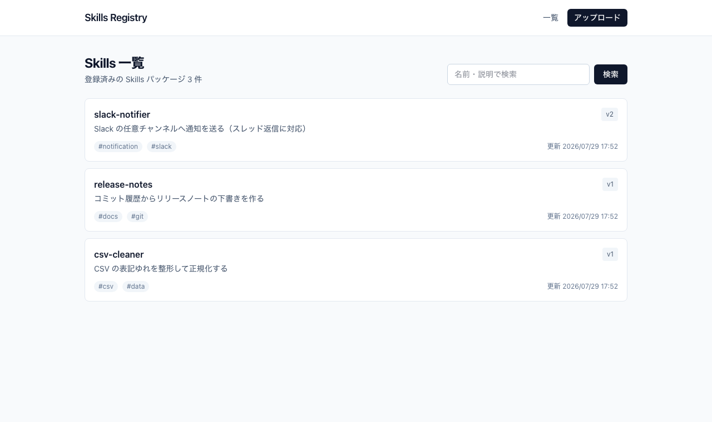

# Skills Registry

Skills パッケージ（`SKILL.md` を含む ZIP）を **登録・検索・配布** する社内向けレジストリ。

このリポジトリの目的は「**Skills レジストリを作るときに何をどう決めるべきか**」を、動くもので検証すること。ZIP という危険な入力を受け取るシステムのセキュリティ設計、将来のクラウド移行を見据えた抽象化の引き方、App Router のサーバ／クライアント境界——これらを実際に手を動かして確かめ、判断の過程を [ADR](docs/adr/README.md) として残している。

**成果物はコードだけではなく、判断の記録も含む。** 迷ったところは [docs/learnings.md](docs/learnings.md) に率直に書いてある。



<details>
<summary>詳細画面・アップロード画面</summary>


</details>

---

## 5 分で動かす

必要なもの: **Docker** だけ（Python / Node.js のローカルインストールは不要）。

```bash
docker compose up --build
```

- 画面: http://localhost:3000
- API ドキュメント（Swagger UI）: http://localhost:8000/docs

ポートが他のプロジェクトと衝突する場合は、ホスト側だけ変更できる。

```bash
BACKEND_PORT=8010 FRONTEND_PORT=3010 docker compose up --build
```

### 試してみる

1. 「アップロード」から ZIP をドラッグ＆ドロップする。手元に無ければ、以下で作れる。

```bash
mkdir -p /tmp/my-skill && cat > /tmp/my-skill/SKILL.md <<'EOF'
---
name: my-first-skill
description: 動作確認用のサンプル
tags: [sample]
---

# 使い方
EOF
(cd /tmp && zip -r my-skill.zip my-skill)
```

2. 一覧で検索し、詳細でファイル構成と版履歴を確認する
3. 同じ名前のまま `SKILL.md` を書き換えて再アップロードすると、**新しい版**として追加される
4. 危険な ZIP（`../` を含むもの等）を投げると、日本語のエラーで拒否される

### 止める

```bash
docker compose down
```

DB とアップロード済みファイルごと消す場合は `docker compose down -v` と `rm -rf ./storage`。

---

## Skills パッケージの形式

ZIP のルート直下、または **1 階層下のディレクトリ直下** に `SKILL.md` を 1 つ置く。

```
my-skill.zip
└── my-skill/
    ├── SKILL.md      ← ここか、ZIP のルート直下
    └── scripts/
        └── run.sh
```

`SKILL.md` の先頭に YAML frontmatter を書く。`name` と `description` が必須、`tags` は任意。

```markdown
---
name: slack-notifier
description: Slack の任意チャンネルへ通知を送る
tags: [slack, notification]
---
```

同じ `name` で再アップロードすると、新しい Skill ではなく**新しい版**になる。

---

## 設計

判断の記録が主たるドキュメント。結論よりも「なぜ他の案を採らなかったか」に重心を置いている。

| ドキュメント | 内容 |
|---|---|
| [docs/design.md](docs/design.md) | 全体像（構成図・ER 図・API 仕様・ディレクトリ構成）を 1 ページに |
| [docs/adr/](docs/adr/README.md) | 設計判断 5 本。各案の Pros / Cons と、**いつこの判断を見直すか** |
| [docs/learnings.md](docs/learnings.md) | 実装中に詰まった点と、迷って決めきれなかったこと |
| [docs/tasks.md](docs/tasks.md) | 実装のタスク分解 |

とくに次の 2 つが中核。

- **[ADR-002](docs/adr/ADR-002-zip-security-in-memory-inspection.md): ZIP をディスクに展開しない** — `extract` / `extractall` を一度も呼ばない。ファイルシステムへ書き込む処理が存在しなければ、path traversal も symlink 攻撃も成立する先がない。攻撃を検知するのではなく、攻撃が成立する経路を作らない
- **[ADR-001](docs/adr/ADR-001-zip-parsing-sync-vs-async.md): 同期処理を選ぶ** — 非同期ワーカーが解決する問題を、この規模ではまだ抱えていない。ただし「いつ非同期化すべきか」の基準は 3 つ明記してある

### 構成

| | |
|---|---|
| Backend | Python 3.12 / FastAPI / SQLAlchemy 2.0 (async) / Pydantic v2 / PostgreSQL 16 |
| Frontend | Next.js 15 (App Router) / TypeScript / Tailwind CSS |
| インフラ | Docker（マルチステージ）/ docker compose |
| CI | GitHub Actions（ruff / pytest+カバレッジ / ESLint / Prettier / next build） |

**このレジストリは Skills を実行しない。** 保管と配布のみを行う。これはセキュリティ境界であり、恒久的に対象外とする。

---

## 開発

### backend

```bash
cd backend
uv venv --python 3.12 .venv && uv pip install -e ".[dev]"
```

テストは **実 PostgreSQL** に対して回す（JSONB・`DISTINCT ON`・`ILIKE` は PostgreSQL 固有で、SQLite で緑にしても本番の保証にならないため）。DB だけ起動しておく。

```bash
docker compose up -d db
cd backend && .venv/bin/pytest --cov
```

テストは開発用とは**別の DB**（`skills_registry_test`）を自動で作って使う。開発中のデータが消えないようにするため（[learnings.md](docs/learnings.md) 参照）。DB が起動していない場合、API テストはスキップされ、`zip_inspector` の単体テストだけが走る。

```bash
.venv/bin/ruff check . && .venv/bin/ruff format --check .
```

### frontend

```bash
cd frontend && npm ci
npm run dev          # http://localhost:3000
npm run lint && npm run format:check && npm run build
```

`INTERNAL_API_URL`（サーバ用）と `NEXT_PUBLIC_API_URL`（ブラウザ用）で API の URL が分かれている。理由は [ADR-005](docs/adr/ADR-005-frontend-data-fetching.md) を参照。

### 環境変数

すべて [docs/design.md §7](docs/design.md) に一覧がある。compose を使う場合は設定済み。

---

## 既知の制約

プロトタイプとしての割り切りを明示しておく（[docs/design.md §8](docs/design.md) に詳細）。

- **検索は件数に線形**。数千件を超えたら `pg_trgm` を検討する（アプリのクエリ変更は不要）
- **マイグレーションは起動時 `create_all`**。スキーマを変えたら volume を作り直す必要がある。Alembic はデータを消せなくなった時点で導入する
- **ローカルストレージは ECS ではエフェメラル**。本番化には `S3Storage` の実装が必須（差し替えは DI 1 行）
- **認証・認可は未実装**。ロールの設計と嵌め込み位置だけ [design.md §6](docs/design.md) に残してある
