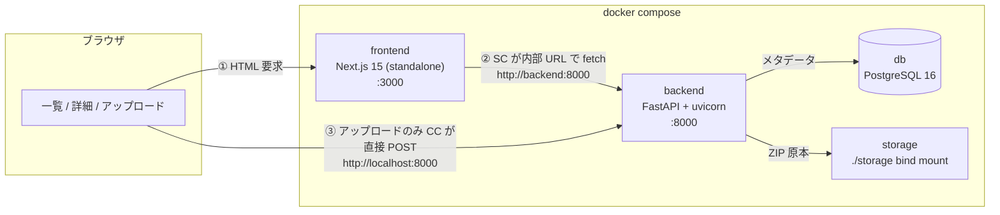
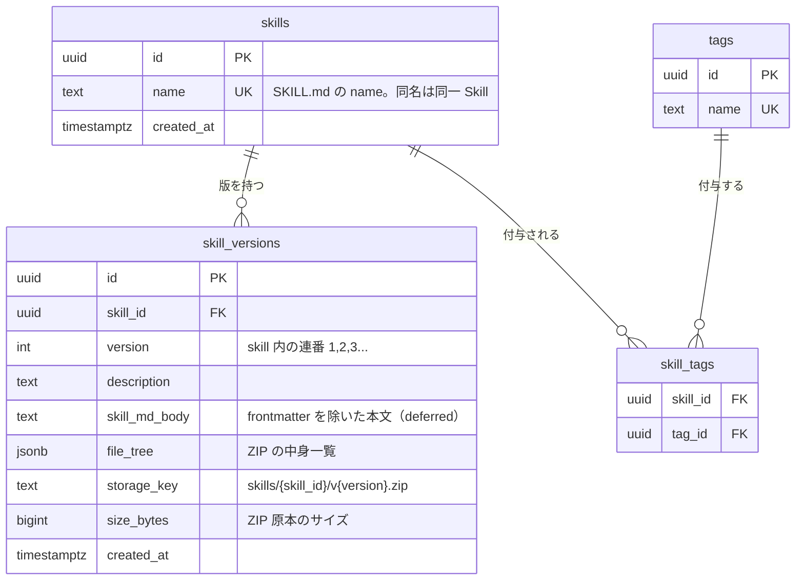
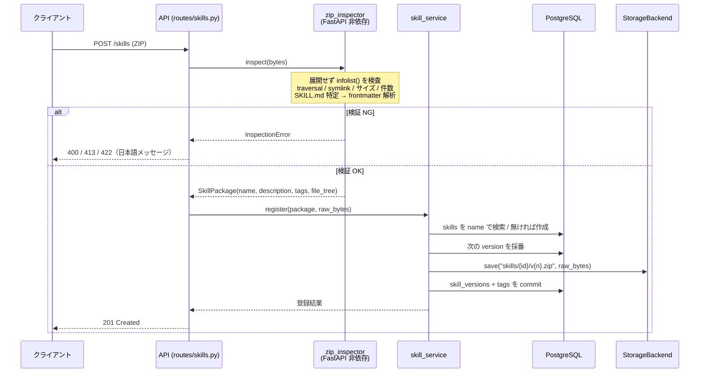

# 設計（design.md）

Skills レジストリの全体像を 1 ページにまとめる。個別の判断理由は [ADR](adr/README.md) を参照。

## 1. このシステムは何をするか

Skills パッケージ（`SKILL.md` を含む ZIP）を **登録・検索・配布** する社内向けレジストリ。

- **する**: ZIP の受け取りと安全性検証、メタデータ抽出、一覧・検索、詳細表示、原本のダウンロード、同名再登録によるバージョニング
- **しない**: Skills の実行（[ADR-002](adr/ADR-002-zip-security-in-memory-inspection.md) のセキュリティ境界。恒久的に対象外）、認証・認可の実装（ロール概念は §6 に設計として残す）

### Skills パッケージの定義

ZIP のルート直下、または **1 階層下のディレクトリ直下** に `SKILL.md` を 1 つ持つ。

```
# OK（ルート直下）              # OK（1階層下）              # NG（2階層下）
my-skill.zip                    my-skill.zip                 my-skill.zip
├── SKILL.md                    └── my-skill/                └── src/
└── scripts/                        ├── SKILL.md                 └── pkg/
    └── run.sh                      └── scripts/                     └── SKILL.md
```

`SKILL.md` の先頭は YAML frontmatter:

```markdown
---
name: slack-notifier
description: Slack の任意チャンネルへ通知を送る
tags: [slack, notification]
---

# 使い方
...
```

`name` / `description` は必須、`tags` は任意。

## 2. 構成



**②と③で API の URL が違う**のがこの構成の要点（[ADR-005](adr/ADR-005-frontend-data-fetching.md)）。②はコンテナネットワーク内の名前解決、③はブラウザから見たホストのポート。`lib/api.ts` で 2 系統を明示的に分ける。

③のためだけに backend に CORS 設定が必要になる。

### コンポーネントの責務

| サービス | 責務 | 状態 |
|---|---|---|
| frontend | 画面の描画。SC からの読み取り fetch | ステートレス |
| backend | ZIP 検証・メタデータ抽出・永続化・配布 | ステートレス（ECS 前提） |
| db | メタデータ（skills / versions / tags） | 永続（named volume） |
| storage | ZIP 原本 | 永続（bind mount。本番は S3 へ差し替え） |

## 3. データモデル



### 設計上の要点

- **`skills.name` が同一性の判断基準**。同名の ZIP を再アップロードすると新しい `skill_versions` 行が増え、`version` がインクリメントされる（新規 Skill にはならない）
- **`skill_versions` に一意制約 `(skill_id, version)`** を張る。同時アップロードによる版番号の衝突を DB で弾く
- **`file_tree` は JSONB**。`[{"path": "SKILL.md", "size": 1234}, ...]` の配列。詳細画面のために ZIP を開き直さなくて済む（[ADR-002](adr/ADR-002-zip-security-in-memory-inspection.md) で検査時に得た情報をそのまま保存する）
- **`description` は版ごと**に持つ。説明文は版とともに変わるため。一覧に出すのは常に最新版の `description`
- **`skill_md_body` は frontmatter を除いた本文**（[ADR-007](adr/ADR-007-store-skill-md-body.md)）。検索対象（[ADR-006](adr/ADR-006-search-multi-token-relevance-snippet.md)）と詳細ページのプレビューが同じカラムで両方成立する。frontmatter を含めない理由は「`name` に当たった Skill が本文にも当たったことになり、ヒット箇所の表示が意味をなさなくなる」ため。SQLAlchemy 上は `deferred` にし、必要な経路だけ `undefer` する（一覧が 1MB × 件数を無条件に引かないようにする）
- **タグは Skill 単位**（版単位ではない）。再アップロード時は最新の frontmatter の内容で張り替える
- **UUID を主キーにする**。連番 ID は「何件登録されているか」を URL から推測させる上、将来の分散化で衝突する

### マイグレーション

**起動時に `Base.metadata.create_all()` でテーブルを作る。Alembic は導入しない。**

プロトタイプとしての明示的な割り切りであり、次のトレードオフを受け入れている:

- できること: `docker compose up` だけで DB が使える状態になる（第三者が 5 分で起動できる、という目標に直結）
- できないこと: カラム追加・型変更が既存 DB に反映されない。スキーマを変えたら volume を作り直す必要がある
- 移行時期: **データを消せなくなった時点**（＝誰かが本気で使い始めた時点）で Alembic を導入する。それ以前に入れても、マイグレーションファイルは全部 initial revision に潰れる

> **フェーズ 2 で `skill_versions.skill_md_body` を追加した**（[ADR-007](adr/ADR-007-store-skill-md-body.md)）。既存の開発 DB には反映されないので、更新後は `docker compose down -v` が必要。データはデモとシードのみで、[`backend/scripts/seed_search_data.py`](../backend/scripts/seed_search_data.py) を 1 回叩けば戻る。**「消せる」状態を保っていることが、Alembic をまだ入れない根拠そのもの**である。

## 4. API

ベース URL: `http://localhost:8000`（compose 内は `http://backend:8000`）。エラーメッセージは **日本語**で返す。

| メソッド | パス | 説明 |
|---|---|---|
| `POST` | `/skills` | ZIP をアップロードして登録（同名なら新しい版） |
| `GET` | `/skills?q=&tag=` | 一覧・検索（最新版のメタデータ） |
| `GET` | `/skills/{id}` | 詳細（ファイルツリー + 版履歴） |
| `GET` | `/skills/{id}/download?version=` | ZIP 原本のダウンロード（省略時は最新版） |
| `GET` | `/health` | ヘルスチェック（DB 接続確認込み） |

### `POST /skills`

`multipart/form-data` の `file` フィールドに ZIP。

処理の流れ（[ADR-001](adr/ADR-001-zip-parsing-sync-vs-async.md) によりすべて同期）:



**ストレージへの保存を DB コミットより先に行う**。逆順にすると「DB にはあるがファイルが無い」状態＝ダウンロードできないレコードが生まれる。先にファイルを置けば、失敗時に残るのは孤児ファイル（無害・後で掃除可能）で済む。

ステータスコードの割り当て:

| コード | 条件 |
|---|---|
| `201` | 登録成功 |
| `400` | ZIP として開けない / 危険なエントリ（path traversal・symlink・絶対パス） |
| `413` | 展開後合計サイズ超過（既定 50MB）/ ファイル数超過（既定 500） |
| `422` | `SKILL.md` が無い・複数ある / frontmatter が不正・`name` や `description` が無い |

「壊れた入力（400）」「大きすぎる入力（413）」「形式は合っているが中身の要件を満たさない（422）」で切り分ける。

### `GET /skills?q=&tag=`

- `q`: **空白区切りの複数語**。半角・全角どちらでも分割し、**全トークンが `name` / `description` / 本文のいずれかに当たる**ものだけを返す（AND。`ILIKE`。[ADR-004](adr/ADR-004-search-postgres-ilike.md) / [ADR-006](adr/ADR-006-search-multi-token-relevance-snippet.md)）。各トークンの `%` `_` はエスケープしてから渡す
- `tag`: タグ名の完全一致。**繰り返しパラメータで複数指定でき、意味は AND**（`?tag=slack&tag=notification`）
- 並び順: `q` 指定時は**関連度順**（トークンごとに `name` 3 点 / `description` 2 点 / 本文 1 点の最高点を合計。同点は最新版 `created_at` 降順）。`q` 無しのときは従来どおり最新版 `created_at` 降順
- 返すのは各 Skill の**最新版**のメタデータ（`id` / `name` / `description` / `tags` / `latest_version` / `updated_at`）に加えて:
  - `matched_fields`: `["name", "description", "body"]` のうち当たったもの（`q` 無しなら空配列）
  - `snippet`: 本文ヒット時、最初のヒット位置の前後 40 文字（本文に当たっていなければ `null`）

役割分担は「**SQL は絞り込み、Python は並べ替えと説明**」。順位とヒット箇所の判定は `app/services/search.py` の純粋関数が担当し、FastAPI にも SQLAlchemy にも依存しない（`zip_inspector.py` と同じ扱い）。

### `GET /skills/{id}`

一覧の項目に加えて `skill_md_body`（最新版の本文。[ADR-007](adr/ADR-007-store-skill-md-body.md)）、`file_tree`（最新版）、`versions`（全版の `version` / `size_bytes` / `created_at`）。

### `GET /skills/{id}/download?version=`

`StreamingResponse` で ZIP を返す。`Content-Disposition: attachment; filename="{name}-v{version}.zip"`。
ストレージから `open()` したストリームをそのまま流し、50MB をメモリに全載せしない（[ADR-003](adr/ADR-003-storage-abstraction.md) で `open()` が `bytes` でなくストリームを返す理由）。

### `GET /health`

`SELECT 1` を実行して DB 接続まで確認する。ECS のヘルスチェックがアプリの生死だけでなく **依存先込みの可用性**を見るため。DB 到達不能なら 503。

## 5. ディレクトリ構成

```
skills-registry/
├── docs/
│   ├── adr/                     ADR 7本 + 索引
│   ├── design.md                このファイル
│   ├── manual-test.md           手動テスト手順書（判定欄つき）
│   ├── tasks.md                 実装タスク分解
│   └── learnings.md             ハマった点・迷った判断（実装中に随時追記）
├── backend/
│   ├── app/
│   │   ├── main.py              FastAPI 生成 / lifespan で create_all / CORS
│   │   ├── core/config.py       pydantic-settings（環境変数はここに集約）
│   │   ├── db/
│   │   │   ├── base.py          DeclarativeBase
│   │   │   ├── models.py        Skill / SkillVersion / Tag
│   │   │   └── session.py       async engine, sessionmaker, get_db
│   │   ├── schemas/skill.py     Pydantic v2 のレスポンス定義
│   │   ├── services/
│   │   │   ├── zip_inspector.py ★ FastAPI 非依存の純粋関数群（ZIP 検証）
│   │   │   ├── search.py        ★ FastAPI 非依存の純粋関数群（順位・ヒット箇所）
│   │   │   └── skill_service.py 永続化と絞り込みのオーケストレーション
│   │   ├── storage/
│   │   │   ├── base.py          StorageBackend Protocol
│   │   │   └── local.py         LocalStorage
│   │   └── api/
│   │       ├── deps.py          DI（DB セッション / ストレージ）
│   │       └── routes/skills.py エンドポイント
│   ├── scripts/
│   │   ├── make_test_zips.py    手動テスト用 ZIP を 16 パターン生成（同梱しない）
│   │   └── seed_search_data.py  検索試験用データを API 経由で投入
│   ├── tests/
│   │   ├── conftest.py
│   │   ├── helpers.py           make_skill_zip()（ZIP を動的生成）
│   │   ├── test_zip_inspector.py
│   │   ├── test_search.py
│   │   └── test_api_skills.py
│   ├── pyproject.toml           依存 / ruff / pytest 設定
│   └── Dockerfile               マルチステージ
├── frontend/
│   ├── app/
│   │   ├── page.tsx             一覧（SC）
│   │   ├── skills/[id]/page.tsx 詳細（SC。Markdown プレビュー）
│   │   ├── upload/page.tsx      アップロード（CC）
│   │   └── _components/         SearchForm(CC) ← このプロジェクト唯一の CC
│   ├── lib/
│   │   ├── api.ts               サーバ用 / ブラウザ用 fetch を分離
│   │   ├── search.ts            検索条件と URL の相互変換（純粋関数）
│   │   └── highlight.tsx        ヒット語の <mark> 包み（純粋関数）
│   ├── next.config.ts           output: "standalone"
│   └── Dockerfile               マルチステージ
├── .github/workflows/ci.yml     lint + test（デプロイジョブは作らない）
├── docker-compose.yml
└── README.md
```

### `zip_inspector.py` / `search.py` を独立させる理由

この 2 つだけが **FastAPI にも SQLAlchemy にも依存しない**。入力は `bytes` や文字列で、出力はデータクラス・数値・リスト。

- `zip_inspector.py` はセキュリティの中核なので、HTTP の文脈なしに単体でテストできることに価値がある（カバレッジ目標 90%+）。[ADR-001](adr/ADR-001-zip-parsing-sync-vs-async.md) の移行基準に抵触して非同期化する日が来ても、**呼び出し元を差し替えるだけ**でロジックは動く
- `search.py` は順位の規則そのもの（[ADR-006](adr/ADR-006-search-multi-token-relevance-snippet.md)）。SQL の巨大な `CASE` 式ではなく Python の関数にしてあるので、**DB を立てずに「name ヒットが本文ヒットより上に来る」を検証できる**

## 6. 認証・認可（設計のみ・今回は実装しない）

実装しないが、後から嵌め込む場所を決めておく。ロールを 3 つ想定する。

| ロール | できること |
|---|---|
| 閲覧者 | 一覧・検索・詳細・ダウンロード |
| 作成者 | 上記 + アップロード |
| 管理者 | 上記 + 版の削除・Skill の削除 |

**嵌め込み位置**: `api/deps.py` に `require_role(Role.CREATOR)` のような依存関数を追加し、各ルートの `dependencies=[...]` に足す。認可の判断をルート定義の宣言部に置くことで、「どのエンドポイントが誰に開いているか」がルータのコードを読むだけで分かる状態を保つ。サービス層には権限の概念を持ち込まない。

[ADR-003](adr/ADR-003-storage-abstraction.md) で `StorageBackend` に `delete()` を含めているのは、管理者ロールの削除機能を見据えているため。

## 7. 設定（環境変数）

すべて `core/config.py`（pydantic-settings）に集約し、コード内に既定値を散らさない。ECS ではタスク定義の環境変数としてそのまま注入できる。

| 変数 | 既定 | 用途 |
|---|---|---|
| `DATABASE_URL` | — | `postgresql+asyncpg://...` |
| `STORAGE_DIR` | `./storage` | `LocalStorage` の保存先 |
| `MAX_TOTAL_SIZE` | `52428800`（50MB） | 展開後合計サイズの上限 |
| `MAX_FILES` | `500` | ZIP 内ファイル数の上限 |
| `CORS_ORIGINS` | `http://localhost:3000` | ブラウザからの直接 POST を許可するオリジン |

frontend 側:

| 変数 | 既定 | 用途 |
|---|---|---|
| `INTERNAL_API_URL` | `http://backend:8000` | Server Component からの fetch |
| `NEXT_PUBLIC_API_URL` | `http://localhost:8000` | ブラウザからの fetch（バンドルに埋め込まれる） |

## 8. 非機能上の前提（明記しておく）

後任者が「なぜ遅いのか / なぜ動かないのか」を探すところから始めなくて済むよう、既知の制約を書き残す。

- **検索は件数に線形**（[ADR-004](adr/ADR-004-search-postgres-ilike.md)）。数千件を超えたら pg_trgm を検討する。関連度のスコアリングも絞り込み済みの行に対して Python で行う（[ADR-006](adr/ADR-006-search-multi-token-relevance-snippet.md)）ので、線形であること自体は変わらない
- **一覧は `SKILL.md` 本文を読まない**（[ADR-007](adr/ADR-007-store-skill-md-body.md)）。`skill_md_body` は `deferred` にしてあり、`q` 指定時の一覧・詳細だけが `undefer` する。ここを外すと一覧が最大 1MB × 件数を引く
- **アップロードは API のワーカーを占有する**（[ADR-001](adr/ADR-001-zip-parsing-sync-vs-async.md)）。同時アップロードが増えたら非同期化を検討する
- **メモリ使用量は「同時アップロード数 × ZIP サイズ」**（[ADR-002](adr/ADR-002-zip-security-in-memory-inspection.md)）。ECS のメモリ設定はこの前提で決める
- **50MB のサイズ上限は経路上のすべてに設定が要る**。ALB / リバースプロキシ側で先に切られると、アプリのエラーメッセージが出ないまま失敗する
- **ローカルストレージは ECS ではエフェメラル**。本番化の際は `S3Storage` の実装が必須（[ADR-003](adr/ADR-003-storage-abstraction.md)）
